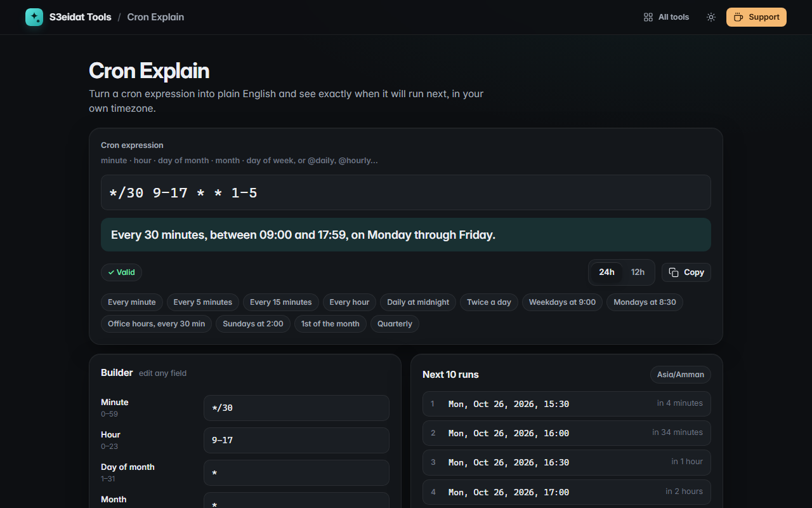

# Cron Explain

> Turn cron expressions into plain English and see the next run times. Free, private, and it runs entirely in your browser.

### ▶ [Open Cron Explain](https://s3eidat.github.io/cron-explain/)



## Features

- Reads standard **5-field cron** (minute, hour, day of month, month, day of week) and the macros
  `@hourly`, `@daily`, `@midnight`, `@weekly`, `@monthly`, `@yearly`, `@annually`, `@reboot`
- **Plain-English description**, e.g. `*/30 9-17 * * 1-5` → *Every 30 minutes, between 09:00 and 17:59, on Monday through Friday*
- **Next 10 run times** in your local timezone, with "in 3 hours"-style countdowns
- **Builder**: edit each field on its own, with **per-field error messages** (out of range, bad ranges,
  Quartz-only `L`/`W`/`#`, 6-field cron with seconds)
- Supports lists, ranges, steps (`*/5`, `9-17/2`), month and weekday names, and `7` as Sunday
- Follows real cron rules: when both day-of-month and day-of-week are set, either one matching is enough
- **Presets** for common schedules, 24h/12h clock, copy button

## Privacy

Nothing is sent anywhere. There is no server, no account, no analytics.
The page ships with a strict Content-Security-Policy (`connect-src 'self'`), so the browser
itself blocks any attempt to send data anywhere.

## Run it yourself

It's plain HTML, CSS and JavaScript with no build step:

```bash
git clone https://github.com/s3eidat/cron-explain
cd cron-explain
python -m http.server 8000
```

Then open http://localhost:8000.

## Support

If this saved you time, **[buy me a coffee ☕](https://s3eidat.github.io/coffee/)**. It keeps every tool free.

---

Part of **[S3eidat Tools](https://s3eidat.github.io/)**: 100+ free, private tools that run in your browser. MIT licensed.
